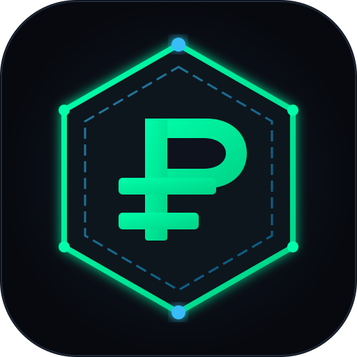

<p align="center">
  
</p>

<h1 align="center">SmartBudget Android</h1>

<p align="center">
  <b>Киберпанк-ассистент персональных финансов, умного рациона и автоматического учета расходов</b><br>
  Разработано в дизайн-системе экосистемы <b>Sentinel Dark Cyber</b> для Android 15.
</p>

<p align="center">
  
  
  
  
  
</p>

---

## 🎯 О проекте

**SmartBudget** — автономное финансовое мобильное приложение под Android, созданное для решения проблемы кассовых разрывов между выплатами зарплаты и аванса. 

Приложение рассчитывает безопасный суточный лимит трат, ведет учет расходов, синхронизируется с пуш-уведомлениями **Mir Pay**, генерирует ротационный рацион питания с учетом персонального стоп-листа аллергенов и автоматически формирует корзину продуктов в супермаркетах (**ВкусВилл**, **Лента**, **Яндекс.Лавка**).

---

## ✨ Ключевые возможности

### 1. ⚡ Автоматический учет покупок Mir Pay (Безопасный парсинг)
- Фоновая служба `MirPayNotificationListener` на базе Android `NotificationListenerService`.
- Автоматически считывает всплывающие уведомления оплаты покупок (например: `«Сумма 60 ₽. 22.11.2026, 13:57. Карта Mir • • • • 2500»`).
- **Строгая защита приватности:** регулярное выражение парсит **исключительно сумму платежа**. Номер карты, дата, имя владельца и местоположение отбрасываются и нигде не сохраняются.

### 2. 🗓️ Календарь выплат по ТК РФ и гибкие даты
- Учет требований **ст. 136 ТК РФ**: если день выплаты выпадает на выходной или праздничный день, начисление переносится на ближайший предшествующий рабочий день.
- Раздел **«Настройки»** позволяет выбрать **любые дни выплат (1..31)** чекбоксами.
- Для каждого выбранного дня формируются динамические поля ввода ожидаемой суммы зарплаты и расходов на жилье/аренду.

### 3. 🍱 Умный рацион питания и доставка в 1 клик
- 15/30-дневное ротационное меню (Завтрак, Обед, Ужин, Перекус) с рассчитанным КБЖУ.
- **Интерактивная карточка «Как приготовить»**: пошаговая инструкция, список ингредиентов и встроенный кухонный таймер обратного отсчета с звуковым сигналом.
- **Мульти-магазинная доставка**: поддержка прямой передачи корзины в приложения **ВкусВилл**, **Лента Онлайн** и **Яндекс.Лавка** с надежным фолбэком на веб-каталоги.

### 4. 🚫 Расширенный стоп-лист (30+ категорий и аллергенов)
- Быстрое исключение нежелательных продуктов по нажатию на строку категории:
  - **Мясо и птица:** свинина, говядина, телятина, курица, индейка, утка, гусь, баранина, кролик, субпродукты, бекон.
  - **Рыба и морепродукты:** белая рыба, красная рыба, тунец, креветки, кальмары, мидии, икра.
  - **Овощи и зелень:** кинза, сельдерей, брокколи, цветная капуста, брюссельская капуста, лук, чеснок, грибы, баклажаны, кабачки, болгарский перец, чили, томаты, огурцы, оливки.
  - **Аллергены и диета:** лактоза, глютен, орехи, арахис, соя, кунжут, мед, сахар.
- Добавление неограниченного числа собственных стоп-слов.

### 5. 📖 Библиотека рецептов
- Отдельный экран навигации со всеми доступными рецептами, фильтрами по приемам пищи и поиском по ингредиентам.
- Рецепты автоматически фильтруются в соответствии с активным стоп-листом.

### 6. 🚀 Встроенный OTA-апдейтер с GitHub
- Экран настроек связывается с официальным репозиторием [`retr0hck3r/SmartBudget`](https://github.com/retr0hck3r/SmartBudget).
- Проверяет свежие релизы через GitHub Releases API и скачивает новый APK в один клик.

### 7. 🎨 Sentinel Dark Cyber дизайн
- Полная адаптация под дизайн-систему [`sentinel-mobile`](https://github.com/blackalex1/sentinel-mobile):
  - Фон: Deep Cyber Dark (`#07090E`, `#0D121D`)
  - Карточки: Slate Navy (`#131B2E`)
  - Акценты: Neon Emerald (`#00FFAA`), Cyber Cyan (`#38BDF8`), Amber (`#F59E0B`), Rose (`#F43F5E`)

---

## 🏗️ Архитектура и стек технологий

```text
SmartBudget/
├── app/src/main/java/com/smartbudget/app/
│   ├── SmartBudgetApplication.kt         # Инициализация синглтонов и базы
│   ├── data/
│   │   ├── local/                       # Room SQLite, DAO и SettingsManager
│   │   ├── network/                     # StoreDeliveryManager, UpdateChecker, MCP клиент
│   │   └── repository/                  # BudgetRepository (единый источник правды)
│   ├── domain/
│   │   ├── calculator/                  # Распределение бюджета по методу 110%
│   │   ├── calendar/                    # Производственный календарь РФ (ст. 136 ТК РФ)
│   │   ├── menu/                        # Ротационное меню, каталог и тайминги
│   │   └── stoplist/                    # 30+ категорий стоп-листа и фильтр
│   ├── service/
│   │   └── MirPayNotificationListener.kt# Фоновый парсер пушей Mir Pay
│   ├── ui/
│   │   ├── MainActivity.kt              # Навигация (7 ключевых экранов)
│   │   ├── screens/                     # Main, Income, Menu, Recipes, Preferences, History, Settings
│   │   └── theme/                       # Sentinel Cyber Dark Color Scheme & Typography
│   └── widget/                          # Glance AppWidgets для рабочего стола
```

---

## 🛠️ Сборка и установка

### Требования
- JDK 21+
- Android SDK 35 (Android 15)
- Gradle 8.10+

### Сборка Debug APK
```bash
./gradlew assembleDebug
```
Готовый установочный файл сохраняется по пути:
`app/build/outputs/apk/debug/app-debug.apk`

---

## 🔒 Безопасность и конфиденциальность

1. **Mir Pay:** Приложение требует стандартное разрешение `BIND_NOTIFICATION_LISTENER_SERVICE`. Считываются исключительно уведомления, содержащие маркеры оплаты, и извлекается только числовая сумма. Никакие платежные реквизиты не передаются во внешнюю сеть.
2. **Локальное хранение:** Все финансовые транзакции, суммы доходов и стоп-листы хранятся строго локально на устройстве в защищенной базе данных Room (SQLite).

---

## 👨‍💻 Автор

Репозиторий проекта: [https://github.com/retr0hck3r/SmartBudget](https://github.com/retr0hck3r/SmartBudget)  
Экосистема Sentinel: [https://github.com/blackalex1/sentinel-mobile](https://github.com/blackalex1/sentinel-mobile)
